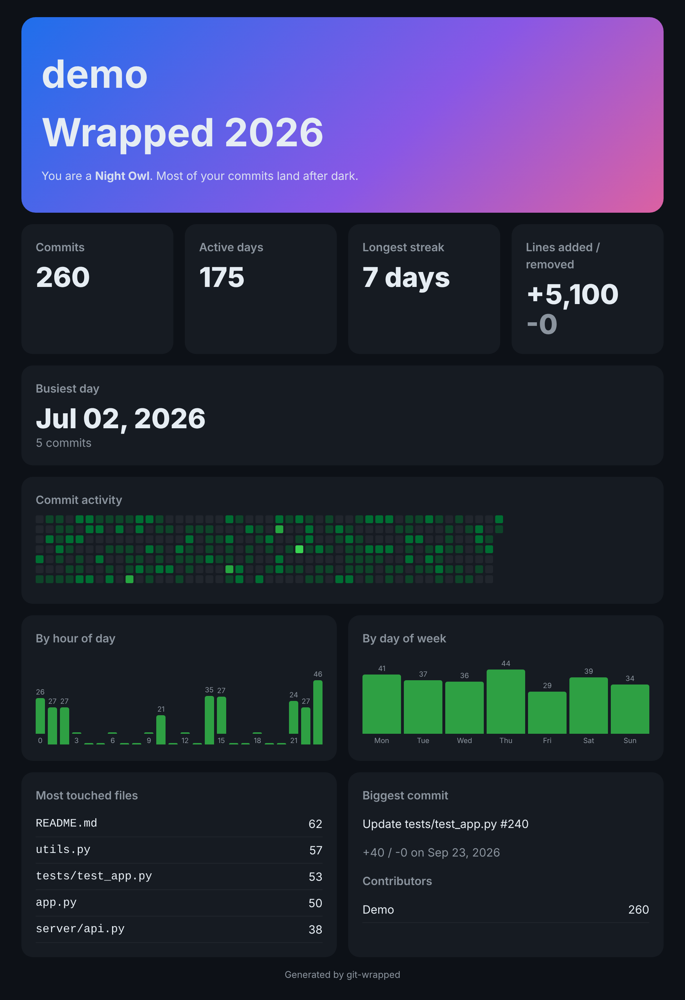

# git-wrapped

A "Spotify Wrapped" for your git history. Point it at any repo and get a single
shareable HTML page: commit heatmap, longest streak, busiest day, your coding
personality, most touched files and more.



## Usage

No dependencies. Needs Python 3.8+ and git.

```bash
python git_wrapped.py                      # current repo, all time
python git_wrapped.py ~/code/myproject --year 2026
python git_wrapped.py . --author "Your Name" -o me.html
```

Open the generated `wrapped.html` in a browser. It is one self-contained file, so
you can host it anywhere or screenshot it.

## Options

| Flag | Meaning |
|------|---------|
| `repo` | Path to a git repo (default `.`) |
| `--year` | Only count commits from this year |
| `--author` | Filter by author name or email |
| `-o, --out` | Output file (default `wrapped.html`) |

## How the personality is picked

Night Owl, Early Bird, Weekend Warrior or Nine-to-Fiver, based on when most of
your commits land.

See [examples/example.html](examples/example.html) for sample output.
